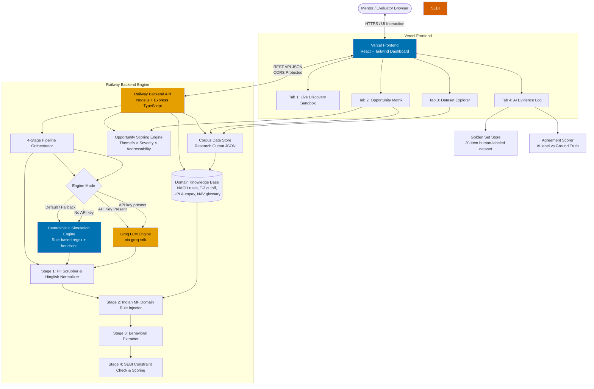
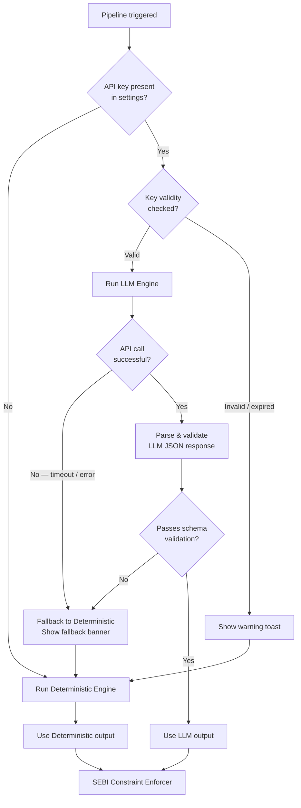

# Groww SIP Retention — AI Discovery Engine
## Detailed System Architecture

---

## Table of Contents

1. [Architecture Overview](#1-architecture-overview)
2. [High-Level System Diagram](#2-high-level-system-diagram)
3. [Frontend Application Architecture](#3-frontend-application-architecture)
4. [Processing Engine Architecture](#4-processing-engine-architecture)
5. [The 4-Stage Discovery Pipeline](#5-the-4-stage-discovery-pipeline)
6. [Data Layer Architecture](#6-data-layer-architecture)
7. [Opportunity Scoring Engine](#7-opportunity-scoring-engine)
8. [LLM Integration & Dual-Engine Design](#8-llm-integration--dual-engine-design)
9. [SEBI Constraint Enforcement Layer](#9-sebi-constraint-enforcement-layer)
10. [Component Tree & UI Architecture](#10-component-tree--ui-architecture)
11. [State Management Architecture](#11-state-management-architecture)
12. [Tab-by-Tab Feature Architecture](#12-tab-by-tab-feature-architecture)
13. [Domain Knowledge Base Structure](#13-domain-knowledge-base-structure)
14. [Error Handling & Fallback Architecture](#14-error-handling--fallback-architecture)
15. [File & Directory Structure](#15-file--directory-structure)
16. [Design System & Theming Architecture](#16-design-system--theming-architecture)
17. [Key Data Contracts (TypeScript Interfaces)](#17-key-data-contracts-typescript-interfaces)
18. [Non-Functional Requirements](#18-non-functional-requirements)

---

## 1. Architecture Overview

The **Groww SIP Retention — AI Discovery Engine** is built as a **decoupled full-stack web application**:
* **Frontend deployed on Vercel:** High-performance React 18 + Vite / Next.js SPA rendering the 4 analytical tabs, Okabe-Ito color-blind safe charts, and real-time state management.
* **Backend deployed on Railway:** High-throughput Node.js + Express (TypeScript) service hosting the 4-Stage Discovery Pipeline, Indian MF plumbing rules, SEBI compliance validation, mathematical opportunity scoring, and secure server-side LLM connectors.

### Core Architectural Principles

| Principle | Rationale |
| :--- | :--- |
| **Separation of Concerns (Vercel + Railway)** | Edge delivery for UI static assets on Vercel; centralized, secure, low-latency business logic execution on Railway |
| **Server-Side Security & Zero-Leakage** | PII redaction and the Groq API key remain safely on Railway; zero sensitive credentials leak to client browser |
| **Dual-Engine Processing with Auto-Fallback** | Railway backend defaults to an in-memory deterministic simulation engine so the app never fails even if external LLM APIs time out |
| **Domain Knowledge as Code** | NPCI, BSE StarMF, and SEBI compliance rules are strictly encoded as typed TypeScript models on the backend |
| **SEBI Constraint Enforcement is Non-Optional** | Constraint checks run as mandatory server-side middleware on every analysis exit |

### Technology Choices

| Layer | Choice | Deployment | Reason |
| :--- | :--- | :--- | :--- |
| Frontend UI | **React 18 + Vite / Next.js** | **Vercel** | Lightning-fast static asset edge serving, responsive fintech dashboard |
| Styling | **Tailwind CSS v3** | **Vercel** | High-density fintech dashboard tokens with Okabe-Ito color-blind safety |
| State Management | **Zustand + React Hooks** | Client | Lightweight client-side reactive store for tab interactions |
| Backend Runtime | **Node.js 20 LTS + TypeScript** | **Railway** | Strict type safety shared with frontend, non-blocking asynchronous event loop |
| Backend Framework | **Express / Fastify** | **Railway** | Modular REST routing, CORS, helmet security headers, and healthchecks |
| LLM Provider | **Groq SDK** (`groq-sdk`) | **Railway** | Sole LLM provider — server-side execution preventing credential exposure; ultra-fast inference via Groq's LPU |
| Embedding Model | **BGE (BAAI/bge-small-en-v1.5)** | **Railway** | Open-source, self-hosted embedding model for semantic similarity — no external API dependency |
| Orchestration | **Monorepo (`frontend/`, `backend/`, `shared/`)** | Git / CI/CD | Single repository sharing `@shared/types` across both layers |

---

## 2. High-Level System Diagram



---

## 3. Frontend Application Architecture

### Application Shell

The application is a single HTML entry point (`index.html`) that mounts a React root. The shell handles:
- Global theme application (dark navy class on `<html>`)
- Global font loading (Inter or Geist for dashboard density)
- Top-level error boundary (catches runtime errors and renders a safe fallback)
- Router provider and global state provider wrapping the tab layout

### Tab Navigation

Navigation is implemented as a **top tab bar** with four named routes. Each tab is a lazy-loaded React component to keep the initial bundle small. Active tab state is persisted to `sessionStorage` so that page refresh returns the user to the same tab.

```
/ (or /#/)              → Tab 1: Live Discovery Pipeline  (default)
/#/opportunity-matrix   → Tab 2: Opportunity Matrix & Discovery Questions
/#/dataset-explorer     → Tab 3: Dataset Explorer
/#/evidence-log         → Tab 4: AI Evidence Log & Golden Set
```

### Settings Drawer

A slide-out settings drawer (accessible via a gear icon in the header) houses:
- **API Key input** for Groq
- Engine mode toggle (Auto / Force Deterministic / Force LLM)
- Key validation indicator (shows ✅ or ❌ after a lightweight test call)

The Groq API key is stored only in component state for the session — never in `localStorage` or `sessionStorage`, and never sent anywhere except the Railway backend for server-side Groq calls.

---

## 4. Processing Engine Architecture

The pipeline orchestrator is the central logic unit of Tab 1. It accepts a raw verbatim string and coordinates the 4-stage pipeline, routing through either the deterministic or LLM engine depending on availability.

```mermaid
flowchart LR
    RAW[Raw Verbatim\nstring] --> ORCH[Pipeline Orchestrator\nuseDiscoveryPipeline hook]

    ORCH --> CHECK{API key\nconfigured?}
    CHECK -->|No| DET_RUNNER[Deterministic Runner]
    CHECK -->|Yes| LLM_RUNNER[LLM Runner]

    DET_RUNNER --> DET_S1[deterministic/stage1.ts\nPII scrub + Hinglish map]
    DET_S1 --> DET_S2[deterministic/stage2.ts\nDomain rule match]
    DET_S2 --> DET_S3[deterministic/stage3.ts\nBehavioral extraction]
    DET_S3 --> DET_S4[deterministic/stage4.ts\nConstraint check]

    LLM_RUNNER --> LLM_S1[llm/stage1Prompt.ts\nSystem + user prompt]
    LLM_S1 --> LLM_S2[llm/stage2Prompt.ts]
    LLM_S2 --> LLM_S3[llm/stage3Prompt.ts]
    LLM_S3 --> LLM_S4[llm/stage4Prompt.ts]
    LLM_S4 --> PARSE[Response Parser\n+ Schema Validator]

    DET_S4 --> MERGE[Output Merger\nStageResult[]]
    PARSE --> MERGE

    MERGE --> CONSTRAINT[SEBI Constraint Enforcer\nFinal validation pass]
    CONSTRAINT --> OUTPUT[PipelineOutput\nStructured JSON + UI state]
```

### Pipeline Output Contract

Every pipeline run, regardless of engine, produces a single `PipelineOutput` object consumed by the UI. This contract is the single source of truth between engine logic and rendering.

---

## 5. The 4-Stage Discovery Pipeline

### Stage 1 — PII Scrubber & Hinglish Semantic Normalizer

**Responsibility:** Clean the raw input before any domain analysis.

**Deterministic path:**
- **PII Masking:** Regex-based detection and replacement of:
  - Phone numbers (10-digit Indian mobile, with/without `+91`)
  - Bank account numbers (9–18 digit sequences)
  - Personal names (heuristic: capitalized tokens adjacent to first-person pronouns)
  - UPI IDs (pattern: `*@*`)
  - Email addresses
- **Hinglish Normalization:** A structured lookup table maps common Hinglish colloquials to their structured English equivalents:

  | Hinglish Input | Normalized English Intent |
  | :--- | :--- |
  | `"kat liya"` | `"was deducted"` |
  | `"bounce ho gaya"` | `"NACH debit failed / bounced"` |
  | `"band kar diya"` | `"cancelled / stopped"` |
  | `"PhonePe se delete kar diya"` | `"UPI Autopay mandate revoked via PhonePe"` |
  | `"ghata ho raha hai"` | `"portfolio is at a loss"` |
  | `"FD better hai"` | `"Fixed Deposit seems preferable"` |
  | `"paise nahi the"` | `"insufficient funds / cashflow crunch"` |

**Output:** `Stage1Result { scrubbed: string, piiEntitiesFound: string[], hinglishTokensNormalized: string[] }`

---

### Stage 2 — Indian MF Domain Rule Injector

**Responsibility:** Given the normalized text, identify which Indian MF / NPCI / BSE domain rules are contextually relevant and surface them as structured context objects.

**Deterministic path:**
- A **Domain Knowledge Base** (see §13) contains typed rule objects, each with: `id`, `name`, `triggerKeywords: string[]`, `explanation`, and `sebiRelevance: boolean`.
- Stage 2 scans the Stage 1 output for keyword matches against each rule's `triggerKeywords` array.
- Matched rules are attached to the output as "active domain context" — they inform Stage 3's extraction and are displayed to the user as highlighted rule cards.

**Rules in scope (examples):**

| Rule ID | Name | Sample Trigger Keywords |
| :--- | :--- | :--- |
| `RULE_T3_LOCKOUT` | T-3 Mandate Presentation Lock-in | `"pause"`, `"cancel"`, `"yesterday"`, `"deducted after"` |
| `RULE_NACH_BOUNCE` | NACH / ECS Bounce Penalty | `"bounce"`, `"penalty"`, `"charge"`, `"295"`, `"590"` |
| `RULE_UPI_REVOKE` | UPI Autopay External Revocation | `"PhonePe"`, `"GPay"`, `"Google Pay"`, `"autopay delete"` |
| `RULE_NAV_CONFUSION` | NAV vs. P&L Misinterpretation | `"loss"`, `"-2%"`, `"negative"`, `"FD better"`, `"red"` |
| `RULE_RCA_UNIT_AVG` | Rupee-Cost Averaging Education Gap | `"units"`, `"more units"`, `"dip"`, `"average"` |
| `RULE_SEBI_ADVISORY` | SEBI Advisory Restriction Trigger | `"which fund"`, `"best fund"`, `"should I switch"`, `"recommend"` |

**Output:** `Stage2Result { activeDomainRules: DomainRule[], augmentedContext: string }`

---

### Stage 3 — Structured Behavioral Extraction

**Responsibility:** Using the normalized text and active domain rules, extract a structured behavioral profile of the investor.

**Extraction targets:**

| Field | Type | Description |
| :--- | :--- | :--- |
| `investorLifecycleStage` | `enum` | `MONTH_0_1` / `MONTH_2_4` / `MONTH_5_8` / `MONTH_9_12` / `UNKNOWN` |
| `userSegment` | `enum` | `YOUNG_SALARIED` / `FREELANCER_GIG` / `FAMILY_INFLUENCED` / `UNKNOWN` |
| `primaryFrictionTheme` | `ThemeID` | Maps to one of the discovered canonical friction themes |
| `insideAppConfusion` | `string` | Free-text description of in-app confusion point detected |
| `outsideAppWorkaround` | `string \| null` | Action taken outside the Groww app, if any |
| `churnSeverity` | `1 \| 2 \| 3 \| 4 \| 5` | Severity of churn signal (1 = minor friction, 5 = active cancellation) |
| `churnSeverityRationale` | `string` | One-sentence explanation of the severity score |
| `emotionalSignals` | `string[]` | Keywords indicating emotional state (frustration, panic, resignation, etc.) |

**Deterministic path — classification logic:**

- `investorLifecycleStage`: Regex patterns on month mentions (`"5 months ho gaye"` → `MONTH_5_8`), keyword signals (`"first SIP"` → `MONTH_0_1`).
- `userSegment`: Salary-day references → `YOUNG_SALARIED`; mentions of irregular income / freelance → `FREELANCER_GIG`; parental advice mentions → `FAMILY_INFLUENCED`.
- `churnSeverity`: A weighted scoring model based on active domain rules and keyword severity markers:
  - Cancelled mandate or SIP → severity 5
  - Expressed intent to cancel → severity 4
  - Confusion + negative emotion, no action yet → severity 3
  - General friction, no churn signal → severity 1–2

**Output:** `Stage3Result { behavioralProfile: BehavioralProfile }`

---

### Stage 4 — SEBI Constraint Check & Opportunity Contribution

**Responsibility:** Validate the extracted behavioral profile against SEBI and case constraints; compute this record's weighted contribution to the opportunity scoring model.

**Constraint checks:**

| Check ID | Condition | Outcome |
| :--- | :--- | :--- |
| `CHK_FUND_ADVISORY` | `primaryFrictionTheme` involves a fund recommendation desire | `addressabilityWeight = 0.2`, flag `SEBI_RESTRICTED` |
| `CHK_FOMO_CONTENT` | Input contains urgency / fear / FOMO language | Flag `FOMO_DETECTED`, suppress in output |
| `CHK_STOCK_TIP` | Stock or fund-specific return prediction detected | Flag `ADVISORY_BOUNDARY_CROSSED` |
| `CHK_ADDRESSABLE` | No SEBI flag raised | `addressabilityWeight = 1.0` or `0.7` based on platform dependency |

**Opportunity contribution:**

Each processed record contributes to the aggregate corpus-level opportunity score by:
1. Incrementing the count for its `primaryFrictionTheme` (used to compute Theme Share %)
2. Adding its `churnSeverity` to the running mean for that theme
3. Recording its `addressabilityWeight`

**Output:** `Stage4Result { constraintFlags: ConstraintFlag[], addressabilityWeight: number, opportunityContribution: OpportunityContribution }`

---

## 6. Data Layer Architecture

The application has no runtime database. All structured data is maintained as typed TypeScript/JSON files imported at build time.

```
src/data/
├── corpus/
│   ├── verbatims.ts          # The representative sample verbatims shown in Tab 3
│   └── corpusSummary.ts      # Aggregate stats (total records, per-channel counts) — populated from research
├── themes/
│   └── frictionThemes.ts     # Discovered canonical themes with metadata (populated post-research)
├── goldenSet/
│   └── goldenSet.ts          # 20-item human-labeled ground truth dataset for Tab 4
├── discoveryAnswers/
│   └── answers.ts            # Answers to the 9 core discovery questions (populated post-research)
└── domainKnowledge/
    ├── domainRules.ts         # Full typed domain rule objects (T-3, NACH, UPI, NAV, etc.)
    └── glossary.ts            # Domain glossary entries
```

### Data Population Strategy

| File | Populated When | By Whom |
| :--- | :--- | :--- |
| `verbatims.ts` | After corpus collection & filtering | PM researcher |
| `corpusSummary.ts` | After research phase completes | PM researcher |
| `frictionThemes.ts` | After corpus analysis & theme clustering | PM researcher |
| `answers.ts` | After discovery question synthesis | PM researcher |
| `goldenSet.ts` | Before engine is built | PM researcher (human labels) |
| `domainRules.ts` | At build time — these are domain facts | Engineer |

> [!IMPORTANT]
> `frictionThemes.ts`, `corpusSummary.ts`, and `answers.ts` are intentionally left as empty/stub files until research is complete. The UI gracefully handles missing data with "Pending Research" placeholder states.

---

## 7. Opportunity Scoring Engine

The opportunity scoring engine is a pure function module — no side effects, no state.

### Scoring Formula

$$\text{Opportunity Score} = \text{Theme Share (\%)} \times \text{Mean Churn Severity (1–5)} \times \text{Constraint Addressability (0–1)}$$

### Implementation

```
src/engine/opportunityScoring.ts
```

**Inputs:**
- `themes: FrictionTheme[]` — from `frictionThemes.ts` (post-research)
- `totalCorpusSize: number` — from `corpusSummary.ts`

**Computation per theme:**
1. `themeShare = theme.recordCount / totalCorpusSize * 100`
2. `meanSeverity = average(theme.severityScores[])`
3. `addressability = theme.sebiRestricted ? 0.2 : theme.platformDependent ? 0.7 : 1.0`
4. `opportunityScore = themeShare × meanSeverity × addressability`

**Output:** `ScoredTheme[]` sorted by `opportunityScore` descending — this becomes the ranked opportunity matrix displayed in Tab 2.

### Interactive Weighting in Tab 2

Tab 2 allows the user to adjust weights via sliders:
- **Severity Weight Multiplier** (0.5× to 2×): Amplifies or dampens the severity dimension
- **Addressability Penalty Toggle**: Switches between strict SEBI penalty (0.2×) and relaxed (0.5×) for "what-if" exploration

These adjustments are local UI state — they do not mutate the underlying data.

---

## 8. LLM Integration & Dual-Engine Design

### Engine Selection Logic



### LLM Prompt Architecture

Each stage has a dedicated prompt template file:

```
src/engine/llm/
├── systemPrompt.ts          # Shared system prompt: domain expert persona, SEBI constraints, output format
├── stage1Prompt.ts          # PII + Hinglish normalization instructions + few-shot examples
├── stage2Prompt.ts          # Domain rule injection instructions with rule catalogue
├── stage3Prompt.ts          # Behavioral extraction with typed JSON schema in prompt
└── stage4Prompt.ts          # Constraint check instructions with SEBI rule list
```

**Key prompt design decisions:**
- System prompt establishes a **SEBI-compliant Indian MF domain expert** persona — not a general assistant
- All stage prompts demand **structured JSON output** with a provided schema; no free-text responses
- Few-shot examples in Stage 1 cover Hinglish-heavy inputs to calibrate non-English handling
- Stage 4 prompt explicitly lists what constitutes an advisory boundary violation

### Provider Abstraction

The LLM layer uses **Groq** as the sole provider via `groq-sdk`. No multi-provider abstraction is needed.

```
src/engine/llm/
├── groqProvider.ts      # Groq SDK wrapper implementing LLMProvider interface
└── embeddingProvider.ts # BGE embedding model for semantic similarity
```

The Groq provider implements a simple interface:
```ts
interface LLMProvider {
  complete(messages: ChatMessage[], options: LLMOptions): Promise<string>
}
```

**Model:** `llama-3.3-70b-versatile` (or latest available on Groq). Timeout: 10,000ms via `AbortController`.

### Embedding Model — BGE (BAAI General Embedding)

For semantic similarity tasks (e.g., fuzzy matching verbatims to domain rules, improved theme classification beyond keyword matching), the system uses the open-source **BGE embedding model** (`BAAI/bge-small-en-v1.5`) instead of OpenAI embeddings:

| Property | Detail |
| :--- | :--- |
| **Model** | `BAAI/bge-small-en-v1.5` (or `bge-base-en-v1.5` for higher accuracy) |
| **Runtime** | Self-hosted on Railway via `@xenova/transformers` (ONNX runtime in Node.js) |
| **Embedding Dimension** | 384 (small) or 768 (base) |
| **Advantage** | Zero external API calls, no token costs, runs entirely within Railway — no data leaves the server |
| **Use Cases** | Semantic domain rule matching in Stage 2, fuzzy theme classification in Stage 3, verbatim similarity search in Tab 3 |

```ts
// backend/src/engine/embedding/bgeEmbedder.ts
import { pipeline } from '@xenova/transformers'

let embedder: any = null

export async function getEmbedding(text: string): Promise<number[]> {
  if (!embedder) {
    embedder = await pipeline('feature-extraction', 'Xenova/bge-small-en-v1.5')
  }
  const output = await embedder(text, { pooling: 'cls', normalize: true })
  return Array.from(output.data)
}

export async function cosineSimilarity(a: number[], b: number[]): Promise<number> {
  const dot = a.reduce((sum, ai, i) => sum + ai * b[i], 0)
  return dot // Already normalized, so dot product = cosine similarity
}
```

---

## 9. SEBI Constraint Enforcement Layer

The SEBI constraint enforcer is implemented as an **always-on, post-pipeline middleware** — it runs after Stage 4 regardless of engine mode and cannot be disabled.

### Constraint Registry

```
src/engine/constraints/sebiConstraints.ts
```

Each constraint is a typed rule object:

```ts
interface SEBIConstraint {
  id: string
  name: string
  description: string
  detectionPatterns: RegExp[]        // Applied to both raw input and Stage 3 output
  penaltyType: 'BLOCK' | 'DOWNGRADE' | 'WARN'
  addressabilityOverride?: number    // Overrides computed addressability if triggered
}
```

| Constraint ID | Name | Penalty Type | Addressability Override |
| :--- | :--- | :--- | :--- |
| `SEBI_NO_FUND_REC` | No Fund / Stock Recommendation | `DOWNGRADE` | 0.2 |
| `SEBI_NO_FOMO` | No Fear / FOMO / Urgency Nudge | `WARN` | — |
| `SEBI_NO_RETURN_PRED` | No Return Prediction | `BLOCK` | 0.2 |
| `SEBI_RIA_BOUNDARY` | RIA License Boundary | `DOWNGRADE` | 0.2 |

### Enforcement Outcomes

- **BLOCK:** The opportunity contribution is zeroed out; a red constraint banner is rendered in the UI.
- **DOWNGRADE:** Addressability is set to the override value; an amber warning card is shown.
- **WARN:** A soft informational note is added to the Stage 4 output; no scoring impact.

---

## 10. Component Tree & UI Architecture

```
<App>
├── <ErrorBoundary>
├── <ThemeProvider>               # Applies dark-navy class, injects CSS variables
├── <GlobalStateProvider>         # Zustand store / Context
├── <AppShell>
│   ├── <Header>
│   │   ├── <Logo />
│   │   ├── <TabNav />            # Tab 1–4 navigation bar
│   │   └── <SettingsDrawerTrigger />
│   ├── <SettingsDrawer>          # Slide-out API key + engine config panel
│   └── <Router>
│       ├── <Tab1_LivePipeline>
│       │   ├── <VerbatimInput>   # Textarea + quick-load chips
│       │   ├── <RunButton>
│       │   └── <PipelineViewer>
│       │       ├── <Stage1Card>  # PII scrub output + Hinglish mapping table
│       │       ├── <Stage2Card>  # Matched domain rule cards
│       │       ├── <Stage3Card>  # Behavioral profile badges + JSON viewer
│       │       └── <Stage4Card>  # Constraint flags + opportunity contribution bar
│       │
│       ├── <Tab2_OpportunityMatrix>
│       │   ├── <CorpusSummaryBar>     # Total records, channel breakdown pills
│       │   ├── <OpportunityTable>     # Sortable, filterable theme rankings
│       │   ├── <OpportunityChart>     # Bar/radar chart of scored themes
│       │   ├── <WeightingControls>    # Severity + addressability sliders
│       │   └── <DiscoveryQuestionsAccordion>  # 9-question expandable grid
│       │
│       ├── <Tab3_DatasetExplorer>
│       │   ├── <SearchBar>
│       │   ├── <FilterPanel>          # Source / Lifecycle / Segment / Theme filters
│       │   └── <VerbatimTable>        # Paginated, filterable verbatim rows
│       │
│       └── <Tab4_EvidenceLog>
│           ├── <AgreementScorecard>   # Theme match % + Severity match %
│           ├── <GoldenSetTable>       # 20-item G01–G20 validation table
│           └── <CorrectionCaseStudies>  # 3 PM override story cards
```

---

## 11. State Management Architecture

The application uses a single **Zustand store** (or Context + useReducer if Zustand is excluded from dependencies). State is scoped to three domains:

### Pipeline State (`pipelineSlice`)

```ts
interface PipelineState {
  rawInput: string
  isRunning: boolean
  currentStage: 0 | 1 | 2 | 3 | 4
  stageResults: {
    stage1?: Stage1Result
    stage2?: Stage2Result
    stage3?: Stage3Result
    stage4?: Stage4Result
  }
  error?: string
  engineMode: 'deterministic' | 'llm' | 'fallback'
}
```

### Settings State (`settingsSlice`)

```ts
interface SettingsState {
  groqApiKey?: string
  forceEngine: 'auto' | 'deterministic' | 'llm'
  keyValidationStatus: 'unchecked' | 'valid' | 'invalid'
}
```

### Opportunity Matrix State (`matrixSlice`)

```ts
interface MatrixState {
  scoredThemes: ScoredTheme[]
  sortBy: 'score' | 'share' | 'severity' | 'addressability'
  sortOrder: 'asc' | 'desc'
  severityWeightMultiplier: number   // 0.5–2.0, default 1.0
  strictSEBIPenalty: boolean          // true = 0.2x, false = 0.5x for restricted themes
}
```

---

## 12. Tab-by-Tab Feature Architecture

### Tab 1 — Live Interactive Discovery Workflow

**Flow:**
1. User types or selects a verbatim chip → sets `pipelineSlice.rawInput`
2. "Run Pipeline" button triggers `usePipelineOrchestrator` hook
3. Hook sets `isRunning = true`, `currentStage = 1`, dispatches to engine
4. Each stage resolves sequentially; after each, `currentStage` increments and the corresponding `StageCard` animates in
5. Final output written to `stageResults`; `isRunning = false`

**Quick-Load Chip Design:**
- Each chip is a `Verbatim` object with: `label`, `rawText`, `language` (`en` | `hinglish` | `mixed`), `expectedTheme`, `expectedConstraintFlag`
- Chips are selected to maximize pipeline path coverage — at least one chip per major domain rule and one SEBI-restricted request
- Chips are **real verbatim paraphrases**, not fabricated — sourced from the research corpus

**Stage Card Animation:**
- Cards appear sequentially with a subtle slide-in + fade
- Processing state: animated shimmer placeholder
- Completed state: full content with color-coded badges
- Error state: red border with error message and fallback indicator

---

### Tab 2 — Quantified Opportunity Matrix & 9 Discovery Questions

**Opportunity Table columns:**
- Rank (auto-computed from score)
- Theme Name
- Theme Share % (with mini bar)
- Mean Churn Severity (1–5 dot scale)
- Constraint Addressability badge (color-coded)
- Opportunity Score (bold, right-aligned)

**Discovery Questions Accordion:**
- 9 expandable panels, one per discovery question
- Each panel shows the question, the synthesized answer from research, supporting verbatim excerpts (2–3 examples), and the contributing friction theme(s)
- Panels that are pending research show a "⏳ Research in progress" placeholder

---

### Tab 3 — Dataset Explorer

**Verbatim table columns:**
- ID (corpus reference)
- Source channel badge
- Lifecycle stage pill
- User segment tag
- Verbatim snippet (truncated with expand-on-click)
- Primary friction theme
- Churn severity indicator

**Filter logic:**
- All filters are AND-combined (multi-filter narrows results)
- Search box performs substring match on the verbatim text
- "Clear Filters" resets all to default
- Record count updates live as filters change

---

### Tab 4 — AI Evidence Log & Golden Set Validation

**Agreement Scorecard:**

$$\text{Theme Agreement} = \frac{\text{Exact Theme Matches}}{20} \times 100\%$$

$$\text{Severity Agreement} = \frac{\text{Matches within } \pm 0.5}{20} \times 100\%$$

**Golden Set Table columns:**
- `ID` (G01–G20)
- `Source`
- `Verbatim Snippet` (first 120 chars)
- `Human PM Label` (ground truth theme + severity)
- `AI Engine Label` (computed theme + severity)
- `Match Status` (✅ exact match / ⚠️ partial / ❌ mismatch)
- `Root Cause` (free text, only for ❌ rows)

**Correction Case Study Cards:**
- Fixed set of PM override narratives (populated from research review process)
- Each card: What the AI said → Why it was wrong → What the correct answer is → What domain knowledge corrected it

---

## 13. Domain Knowledge Base Structure

```
src/data/domainKnowledge/domainRules.ts
```

Each rule is a typed object:

```ts
interface DomainRule {
  id: string
  name: string
  category: 'PAYMENT_PLUMBING' | 'NAV_MECHANICS' | 'REGULATORY' | 'UX_CONFUSION'
  summary: string                   // One-line explanation shown in UI
  detailedExplanation: string       // Full explanation shown on rule card expand
  triggerKeywords: string[]         // Used by Stage 2 for keyword matching
  sebiRelevance: boolean            // True if this rule touches a SEBI constraint
  relatedConstraintId?: string      // Link to SEBI constraint if sebiRelevance = true
}
```

**Current domain rule catalogue:**

| Rule ID | Category | Name |
| :--- | :--- | :--- |
| `RULE_T3_LOCKOUT` | PAYMENT_PLUMBING | T-3 Mandate Presentation Lock-in Cutoff |
| `RULE_NACH_BOUNCE` | PAYMENT_PLUMBING | NACH / ECS Bounce Penalty (Bank-Levied) |
| `RULE_UPI_REVOKE` | PAYMENT_PLUMBING | UPI Autopay External Revocation via Third-Party App |
| `RULE_NAV_CONFUSION` | NAV_MECHANICS | NAV Movement ≠ Stock Price Movement |
| `RULE_RCA_UNIT_AVG` | NAV_MECHANICS | Rupee-Cost Averaging — Unit Accumulation at Lower NAV |
| `RULE_NAV_ALLOC_DELAY` | NAV_MECHANICS | NAV Allocation T+1 Delay Post-Debit |
| `RULE_SEBI_ADVISORY` | REGULATORY | SEBI IA Regulation — Advisory Boundary |
| `RULE_MANDATE_REGEN` | PAYMENT_PLUMBING | Mandate Recreation Flow After Cancellation |
| `RULE_INSTALLMENT_VS_DEBIT` | UX_CONFUSION | Installment Status ≠ Bank Debit Confirmation |

---

## 14. Error Handling & Fallback Architecture

### Error Categories

| Category | Handling Strategy |
| :--- | :--- |
| **LLM API timeout** (>10s) | Auto-fallback to deterministic engine; show amber "Using simulation engine" banner |
| **LLM invalid JSON response** | Schema validation catches; fallback to deterministic; log mismatch for debugging |
| **LLM API key invalid / expired** | Show red key-invalid indicator in settings; fallback immediately |
| **Stage parsing failure** | Catch at stage level; emit partial result; skip to next stage with error flag |
| **Corpus data missing / stub** | UI renders "Research pending" placeholder; no crash |
| **Unknown verbatim / no theme match** | Stage 3 emits `primaryFrictionTheme: 'UNCLASSIFIED'`; churn severity defaults to 0; Stage 4 flags for manual review |

### Global Error Boundary

A React `ErrorBoundary` wraps the entire application. Any uncaught render error:
1. Logs the error to `console.error`
2. Renders a clean "Something went wrong" fallback with a "Reload" button
3. Does NOT expose stack traces to the end user

---

## 15. File & Directory Structure

```
groww-sip-discovery/
├── index.html
├── vite.config.ts
├── tailwind.config.ts
├── tsconfig.json
├── package.json
│
├── public/
│   └── favicon.svg
│
└── src/
    ├── main.tsx                        # React root mount
    ├── App.tsx                         # Router + global providers
    │
    ├── components/
    │   ├── layout/
    │   │   ├── AppShell.tsx
    │   │   ├── Header.tsx
    │   │   ├── TabNav.tsx
    │   │   └── SettingsDrawer.tsx
    │   ├── pipeline/
    │   │   ├── VerbatimInput.tsx
    │   │   ├── QuickLoadChips.tsx
    │   │   ├── PipelineViewer.tsx
    │   │   ├── Stage1Card.tsx
    │   │   ├── Stage2Card.tsx
    │   │   ├── Stage3Card.tsx
    │   │   └── Stage4Card.tsx
    │   ├── opportunity/
    │   │   ├── OpportunityTable.tsx
    │   │   ├── OpportunityChart.tsx
    │   │   ├── WeightingControls.tsx
    │   │   ├── CorpusSummaryBar.tsx
    │   │   └── DiscoveryQuestionsAccordion.tsx
    │   ├── dataset/
    │   │   ├── VerbatimTable.tsx
    │   │   ├── FilterPanel.tsx
    │   │   └── SearchBar.tsx
    │   ├── evidence/
    │   │   ├── AgreementScorecard.tsx
    │   │   ├── GoldenSetTable.tsx
    │   │   └── CorrectionCaseStudies.tsx
    │   └── ui/                         # Shared primitive components
    │       ├── Badge.tsx
    │       ├── SeverityDots.tsx
    │       ├── ConstraintFlag.tsx
    │       ├── Accordion.tsx
    │       ├── Tooltip.tsx
    │       └── LoadingShimmer.tsx
    │
    ├── tabs/
    │   ├── Tab1_LivePipeline.tsx
    │   ├── Tab2_OpportunityMatrix.tsx
    │   ├── Tab3_DatasetExplorer.tsx
    │   └── Tab4_EvidenceLog.tsx
    │
    ├── engine/
    │   ├── orchestrator.ts             # Pipeline orchestrator (useDiscoveryPipeline hook)
    │   ├── deterministic/
    │   │   ├── stage1.ts               # PII scrub + Hinglish normalization
    │   │   ├── stage2.ts               # Domain rule injection
    │   │   ├── stage3.ts               # Behavioral extraction
    │   │   └── stage4.ts               # Constraint check + opportunity contribution
    │   ├── llm/
    │   │   ├── systemPrompt.ts
    │   │   ├── stage1Prompt.ts
    │   │   ├── stage2Prompt.ts
    │   │   ├── stage3Prompt.ts
    │   │   ├── stage4Prompt.ts
    │   │   └── groqProvider.ts     # Groq SDK wrapper (sole LLM provider)
    │   ├── embedding/
    │   │   └── bgeEmbedder.ts      # BGE embedding model via @xenova/transformers
    │   ├── constraints/
    │   │   └── sebiConstraints.ts      # SEBI constraint registry + enforcer
    │   └── scoring/
    │       └── opportunityScoring.ts   # Pure scoring function
    │
    ├── data/
    │   ├── corpus/
    │   │   ├── verbatims.ts            # Representative sample verbatims
    │   │   └── corpusSummary.ts        # Aggregate stats (post-research)
    │   ├── themes/
    │   │   └── frictionThemes.ts       # Discovered themes (post-research)
    │   ├── goldenSet/
    │   │   └── goldenSet.ts            # 20-item labeled dataset
    │   ├── discoveryAnswers/
    │   │   └── answers.ts              # 9 discovery question answers (post-research)
    │   └── domainKnowledge/
    │       ├── domainRules.ts          # Full domain rule catalogue
    │       └── glossary.ts             # Glossary entries
    │
    ├── store/
    │   ├── index.ts                    # Zustand store root
    │   ├── pipelineSlice.ts
    │   ├── settingsSlice.ts
    │   └── matrixSlice.ts
    │
    ├── types/
    │   ├── pipeline.ts                 # All pipeline stage types
    │   ├── corpus.ts                   # Verbatim, FrictionTheme, ScoredTheme types
    │   ├── domain.ts                   # DomainRule, SEBIConstraint types
    │   └── golden.ts                   # GoldenSetItem, AgreementScore types
    │
    └── styles/
        ├── globals.css                 # Tailwind base + CSS variable definitions
        └── tokens.css                  # Okabe-Ito palette as CSS custom properties
```

---

## 16. Design System & Theming Architecture

### Color Tokens

All colors are defined as CSS custom properties in `tokens.css` and referenced via Tailwind config:

```css
:root {
  /* Backgrounds */
  --color-bg-primary:    #0F172A;   /* Dark Navy — page background */
  --color-bg-surface:    #1E293B;   /* Slate — card / panel background */
  --color-bg-elevated:   #334155;   /* Elevated surface — modals, drawers */

  /* Text */
  --color-text-primary:  #F8FAFC;   /* Primary text on dark background */
  --color-text-muted:    #94A3B8;   /* Secondary / muted text */
  --color-text-disabled: #475569;   /* Disabled states */

  /* Okabe-Ito Semantic Accents */
  --color-teal:     #0072B2;   /* Positive, verified, low risk */
  --color-vermilion:#D55E00;   /* Critical, high churn, cancellation */
  --color-amber:    #E69F00;   /* Warning, medium risk, pending */

  /* Borders */
  --color-border:   #334155;
}
```

### Typography

| Usage | Font | Weight | Size |
| :--- | :--- | :--- | :--- |
| Page title | Inter / Geist | 700 | 24px |
| Section heading | Inter | 600 | 18px |
| Card label | Inter | 500 | 14px |
| Body / verbatim text | Inter | 400 | 14px |
| Code / JSON | JetBrains Mono | 400 | 13px |
| Badge text | Inter | 600 | 11px |

### Badge Component Design

Badges communicate categorical data at a glance:

| Badge Type | Color | Used For |
| :--- | :--- | :--- |
| Lifecycle Stage | Teal fill | `MONTH_0_1`, `MONTH_2_4`, `MONTH_5_8`, `MONTH_9_12` |
| Churn Severity (1–2) | Amber outline | Low severity |
| Churn Severity (3) | Amber fill | Medium severity |
| Churn Severity (4–5) | Vermilion fill | High / critical severity |
| Constraint: Restricted | Vermilion with ⚠️ | SEBI-restricted theme |
| Constraint: Addressable | Teal with ✅ | Fully addressable theme |
| Source Channel | Slate fill | Play Store, Reddit, YouTube, etc. |

---

## 17. Key Data Contracts (TypeScript Interfaces)

```ts
// Full pipeline output — consumed by Tab 1 UI
interface PipelineOutput {
  rawInput: string
  engineMode: 'deterministic' | 'llm' | 'fallback'
  stages: {
    stage1: Stage1Result
    stage2: Stage2Result
    stage3: Stage3Result
    stage4: Stage4Result
  }
  processingTimeMs: number
  sebiConstraintTriggered: boolean
}

// Behavioral profile (Stage 3 core output)
interface BehavioralProfile {
  investorLifecycleStage: 'MONTH_0_1' | 'MONTH_2_4' | 'MONTH_5_8' | 'MONTH_9_12' | 'UNKNOWN'
  userSegment: 'YOUNG_SALARIED' | 'FREELANCER_GIG' | 'FAMILY_INFLUENCED' | 'UNKNOWN'
  primaryFrictionTheme: string        // ThemeID from frictionThemes.ts, or 'UNCLASSIFIED'
  insideAppConfusion: string
  outsideAppWorkaround: string | null
  churnSeverity: 1 | 2 | 3 | 4 | 5
  churnSeverityRationale: string
  emotionalSignals: string[]
}

// A discovered friction theme (loaded from frictionThemes.ts post-research)
interface FrictionTheme {
  id: string
  name: string
  recordCount: number                 // Filled after corpus analysis
  severityScores: number[]            // One per tagged record
  sebiRestricted: boolean
  platformDependent: boolean
  summary: string
}

// Scored theme (output of opportunityScoring.ts)
interface ScoredTheme extends FrictionTheme {
  themeSharePercent: number
  meanSeverity: number
  addressabilityWeight: number
  opportunityScore: number
  rank: number
}

// Golden set item (Tab 4)
interface GoldenSetItem {
  id: string                          // G01–G20
  source: string
  verbatimSnippet: string
  humanLabel: {
    theme: string
    churnSeverity: number
  }
  aiLabel: {
    theme: string
    churnSeverity: number
  }
  matchStatus: 'exact' | 'partial' | 'mismatch'
  rootCause?: string                  // Only for mismatch rows
}
```

---

## 18. Non-Functional Requirements

| Requirement | Target | How Achieved |
| :--- | :--- | :--- |
| **Zero-dependency startup** | Works without any API key | Deterministic engine runs by default; Groq LLM path is opt-in |
| **Initial load time** | < 3 seconds on average connection | Vite code-splitting; Groq SDK loaded lazily on backend |
| **Pipeline processing time (deterministic)** | < 300ms per verbatim | Pure in-memory regex/heuristic; no network call |
| **Pipeline processing time (LLM)** | < 15s with user feedback | Progress indicator per stage; timeout + fallback at 10s |
| **Embedding inference** | < 100ms per text | BGE model cached in memory after first load on Railway |
| **Accessibility** | WCAG 2.1 AA | Okabe-Ito color-blind-safe palette; semantic HTML; ARIA labels on interactive elements |
| **Mobile responsiveness** | Usable on tablets and above | Tailwind responsive breakpoints; tab bar collapses gracefully below 768px |
| **SEBI constraint enforcement** | 100% — never skippable | Enforcer runs in a finally block after every pipeline exit |
| **Static deployment** | Deploy to any CDN | No backend; pure static Vite output |
| **Corpus data separation** | Research findings never baked into engine logic | All corpus/theme data lives in `src/data/` as separate files with clear stub states |

---

> [!NOTE]
> This architecture document reflects the **design intent** before research is complete. Sections marked "post-research" (particularly `src/data/corpus/`, `src/data/themes/`, and `src/data/discoveryAnswers/`) will be populated once the corpus collection and analysis phases conclude. The engine, constraint layer, domain knowledge base, and UI shell can be built entirely in parallel with research.

