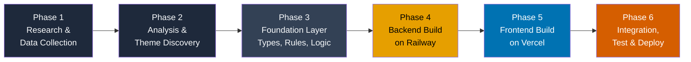

# Groww SIP Retention — AI Discovery Engine
## Phase-Wise Implementation Plan (Research-First → Build Later)

> Derived from [`Architecture.md`](./Architecture.md) and [`problemStatement.md`](./problemStatement.md)

---

## Guiding Principle

**Do the thinking before the building.** Research, data collection, theme analysis, and golden set labeling are completed first. Only after we know *what* the engine needs to say do we design and build the backend (Railway) and frontend (Vercel) — step by step, not all at once.

---

## Master Roadmap



| Phase | Focus | What It Produces | Builds Code? |
| :---: | :--- | :--- | :---: |
| **1** | Research & Data Collection | Raw scraped corpus from 5 channels | No |
| **2** | Analysis & Theme Discovery | Filtered corpus, friction themes, 9 Q&A answers, golden set | No |
| **3** | Foundation Layer | Shared TypeScript types, domain rules, SEBI constraints, scoring logic, Hinglish map | Yes (logic only) |
| **4** | Backend Build (Railway) | Express API server with pipeline engine, REST endpoints, Groq LLM + BGE embeddings | Yes (server) |
| **5** | Frontend Build (Vercel) | React dashboard with 4 interactive tabs wired to backend | Yes (client) |
| **6** | Integration, Test & Deploy | Live Vercel ↔ Railway deployment, smoke tests, polish | Yes (ops) |

---

## Phase 1 — Research & Data Collection

**Goal:** Gather the raw voice-of-customer corpus from all 5 planned source channels. No coding — this is pure PM research work.

### 1.1 Source Channel Scraping

Collect raw public records from each channel:

| Source Channel | Where to Collect | What to Look For |
| :--- | :--- | :--- |
| **Google Play Store Reviews** | Groww app reviews (1–3 star, SIP-related keywords) | App crashes, mandate failures, deduction confusion, bounce complaints |
| **Apple App Store Reviews** | Groww iOS app reviews | UI complaints, mandate modification issues, navigation confusion |
| **Reddit** | `r/personalfinanceindia`, `r/IndiaInvestments` — search "SIP", "Groww", "cancel SIP", "SIP loss" | Long-form emotional posts, portfolio anxiety, peer advice threads |
| **YouTube Comments** | Comment sections on popular SIP tutorial/review videos | Beginner questions, expectation gaps, influencer-driven confusion |
| **FinTech Forums** | TradingQ&A, ValuePickr, Quora (Indian investing topics) | Technical plumbing questions, BSE StarMF reconciliation, NACH issues |

### 1.2 Raw Data Organization

For each scraped record, capture:
- **Source channel** (which platform)
- **Raw text** (verbatim, unedited)
- **Language** (English / Hinglish / Hindi)
- **Date** (approximate, if available)
- **URL / reference** (for traceability)

Store as a structured spreadsheet or CSV — this becomes the input to Phase 2.

### 1.3 Volume Target

No fixed count targets per channel. Scrape broadly; filtering happens in Phase 2. Track the raw total for the final `corpusSummary` stat.

### Phase 1 Exit Criteria
- [ ] Raw records collected from all 5 channels
- [ ] Each record has: source, raw text, language, date
- [ ] Raw corpus stored in an organized spreadsheet/CSV
- [ ] Total raw record count documented

---

## Phase 2 — Analysis & Theme Discovery

**Goal:** Filter the raw corpus to first-time investors only, discover and name the friction themes, answer the 9 discovery questions, and hand-label the 20-item golden set. This phase produces all the *content* the app will display.

### 2.1 First-Time Investor Filtering

Apply the filtering criteria from the problem statement:
- **Include if:** Explicit mention of first SIP / first mutual fund / first investment, OR clear behavioral markers of a new investor (asking what NAV means, comparing SIP to FD as a newcomer, confusion about first installment).
- **Exclude:** Experienced investors discussing portfolio rebalancing, tax harvesting, or multi-year SIP performance.

**Output:** Filtered corpus with a documented count. Record the per-channel breakdown (how many from Play Store, Reddit, etc.).

### 2.2 Theme Clustering

Read through the filtered corpus and identify recurring friction patterns. For each cluster:
- **Name it** — give it a clear, descriptive label
- **Count it** — how many records in the filtered corpus have this as the primary friction driver
- **Score severity** — assign each record in the cluster a churn severity (1–5)
- **Flag SEBI relevance** — does this theme involve fund recommendations or advisory content?
- **Flag platform dependency** — is this theme about infrastructure outside Groww's control (e.g., UPI apps)?

Do NOT pre-decide how many themes there will be. Let the data tell you. It could be 4, 5, 7 — whatever emerges.

**Output:** A list of named `FrictionTheme` objects with `recordCount`, `severityScores[]`, `sebiRestricted`, `platformDependent`, and `summary`.

### 2.3 Answer the 9 Discovery Questions

Using the filtered corpus and discovered themes, write synthesized answers to:

| # | Question |
| :-: | :--- |
| 1 | Why do first-time investors start a SIP, and what are their expectations? |
| 2 | How does behavior/emotion evolve from Month 1 through Month 8–12? |
| 3 | What triggers a decision to pause, skip, or cancel? |
| 4 | What do users monitor in the app, and how often? |
| 5 | What inside-app elements create confusion or misplaced blame? |
| 6 | What outside-app workarounds do investors use? |
| 7 | What distinguishes continuers from drop-offs? |
| 8 | Are there different churn patterns across investor segments? |
| 9 | What consistent unmet needs surface across the corpus? |

For each answer, note 2–3 supporting verbatim quotes from the corpus.

**Output:** 9 `DiscoveryAnswer` objects with `questionText`, `answer`, `supportingVerbatimIds[]`, `relatedThemeIds[]`.

### 2.4 Select 25 Representative Verbatims

Pick 25 rich, diverse verbatims from the filtered corpus that:
- Cover all source channels
- Cover all discovered themes
- Cover multiple lifecycle stages and user segments
- Include both English and Hinglish examples

For each, tag: `source`, `lifecycleStage`, `userSegment`, `primaryThemeId`, `churnSeverity`.

**Output:** 25 fully tagged `Verbatim` objects for the Dataset Explorer (Tab 3).

### 2.5 Golden Set Labeling (20 Items)

Select 20 verbatims (can overlap with the 25 above or be separate). For each:
1. **Human PM labels:** Assign `theme` and `churnSeverity` (this is ground truth)
2. **Leave AI labels empty** — these will be filled by the engine in Phase 4

**Output:** 20 `GoldenSetItem` objects with human labels filled, AI labels as placeholders.

### 2.6 Document PM Correction Cases

During analysis, note any instances where an intuitive or AI-like reading would get the answer wrong:
- Where domain knowledge (T-3 lock-in, SEBI rules) changes the interpretation
- Where surface-level reading misclassifies a record

Write up at least 3 correction case studies with: `aiOutput` (what a naive analysis would say), `rejectionReason`, `correctAnswer`, `domainRuleApplied`.

**Output:** 3+ `CorrectionCaseStudy` objects.

### Phase 2 Exit Criteria
- [ ] Filtered corpus created with per-channel counts documented
- [ ] Friction themes discovered, named, and counted (with severity scores)
- [ ] All 9 discovery questions answered with supporting verbatims
- [ ] 25 tagged representative verbatims selected
- [ ] 20-item golden set human-labeled
- [ ] 3+ PM correction case studies documented
- [ ] All outputs stored in structured format (spreadsheet/JSON) ready for Phase 3

---

## Phase 3 — Foundation Layer (Types, Rules & Logic)

**Goal:** Translate Phase 2 research outputs into typed TypeScript code. Build the domain knowledge base, SEBI constraint enforcer, Hinglish normalizer, and scoring functions as standalone modules — no server, no UI yet. Just pure logic that can be unit-tested.

### 3.1 Monorepo Scaffold

Set up the project structure (no frontend or backend servers yet — just the shared logic):

```
groww-sip-discovery/
├── package.json               # Root workspace
├── pnpm-workspace.yaml
│
├── shared/                    # Shared types & logic (used by both backend and frontend later)
│   ├── package.json
│   ├── tsconfig.json
│   └── src/
│       ├── types/
│       │   ├── pipeline.ts    # Stage1Result, Stage2Result, ..., PipelineResponse
│       │   ├── domain.ts      # DomainRule, SEBIConstraint
│       │   ├── corpus.ts      # Verbatim, FrictionTheme, ScoredTheme, CorpusSummary
│       │   └── golden.ts      # GoldenSetItem, AgreementScore, CorrectionCaseStudy
│       ├── domainKnowledge/
│       │   ├── domainRules.ts
│       │   ├── glossary.ts
│       │   └── hinglishMap.ts
│       ├── constraints/
│       │   └── sebiConstraints.ts
│       └── scoring/
│           ├── opportunityScoring.ts
│           └── agreementScoring.ts
│
├── frontend/                  # Empty — scaffolded in Phase 5
│   └── (empty)
│
└── backend/                   # Empty — scaffolded in Phase 4
    └── (empty)
```

### 3.2 TypeScript Type Definitions (`shared/src/types/`)

Define all data contracts from Phase 2 research:

**`types/pipeline.ts`** — Stage result types, `PipelineRunRequest`, `PipelineResponse`, `BehavioralProfile`, enums (`InvestorLifecycleStage`, `UserSegment`, `EngineMode`).

**`types/domain.ts`** — `DomainRule`, `DomainRuleCategory`, `SEBIConstraint`, `SEBIPenaltyType`, `ConstraintFlag`.

**`types/corpus.ts`** — `Verbatim`, `SourceChannel`, `FrictionTheme`, `ScoredTheme`, `CorpusSummary`, `DiscoveryAnswer`.

**`types/golden.ts`** — `GoldenSetItem`, `MatchStatus`, `AgreementScore`, `CorrectionCaseStudy`.

### 3.3 Domain Knowledge Base (`shared/src/domainKnowledge/`)

**`domainRules.ts`** — Author all domain rules discovered during research. Each rule has: `id`, `name`, `category`, `summary`, `detailedExplanation`, `triggerKeywords[]`, `sebiRelevance`.

**`hinglishMap.ts`** — Populate from Hinglish phrases encountered during Phase 1–2 corpus review. Minimum 12+ phrase mappings.

**`glossary.ts`** — NPCI, NACH, T-3 cutoff, UPI Autopay, NAV, Rupee-Cost Averaging definitions.

### 3.4 SEBI Constraint Enforcer (`shared/src/constraints/sebiConstraints.ts`)

Implement the constraint registry and enforcer function:
- `SEBI_NO_FUND_REC` (DOWNGRADE → 0.2x)
- `SEBI_NO_FOMO` (WARN)
- `SEBI_NO_RETURN_PRED` (BLOCK → 0.2x)
- `SEBI_RIA_BOUNDARY` (DOWNGRADE → 0.2x)
- `enforceSEBIConstraints(rawInput, behavioralProfile)` → returns triggered flags + addressability override

### 3.5 Scoring Functions (`shared/src/scoring/`)

**`opportunityScoring.ts`** — Pure function:
$$\text{Score} = \text{Theme Share (\%)} \times \text{Mean Severity} \times \text{Addressability}$$
Accepts optional `severityMultiplier` and `strictSEBIPenalty` params for interactive what-if.

**`agreementScoring.ts`** — Computes Theme Agreement % and Severity Agreement (±0.5) % from golden set items.

### 3.6 Populate Research Data Files

Convert Phase 2 outputs into typed TypeScript data files:

```
shared/src/data/
├── corpusSummary.ts          # Total raw, filtered, per-channel counts from Phase 2.1
├── verbatims.ts              # 25 tagged verbatims from Phase 2.4
├── frictionThemes.ts         # Discovered themes from Phase 2.2
├── discoveryAnswers.ts       # 9 answers from Phase 2.3
├── goldenSet.ts              # 20 items from Phase 2.5
├── correctionCaseStudies.ts  # 3+ cases from Phase 2.6
└── quickLoadChips.ts         # 5–6 representative verbatims for Tab 1 demo
```

### Phase 3 Exit Criteria
- [ ] `tsc --noEmit` passes cleanly across all shared types
- [ ] All domain rules authored with trigger keywords
- [ ] SEBI enforcer correctly flags advisory queries in manual tests
- [ ] `scoreThemes()` produces correct ranked output for the discovered themes
- [ ] `computeAgreementScore()` runs on the golden set (AI labels still placeholder)
- [ ] All Phase 2 research data converted into typed `.ts` files
- [ ] No frontend, no backend server yet — just the logic layer

---

## Phase 4 — Backend Build on Railway

**Goal:** Build the Express API server step by step. Each sub-step is a self-contained increment that can be tested before moving to the next.

### Step 4.1 — Server Skeleton & Health Check

**What to build:**
- `backend/package.json` with: `express`, `cors`, `helmet`, `dotenv`, `zod`, `pino`, `groq-sdk`, `@xenova/transformers`
- `backend/tsconfig.json` referencing `shared/`
- `backend/src/index.ts` — Express app with JSON body parsing, CORS, helmet
- `backend/src/routes/health.ts` — `GET /api/health` → `{ status: "ok", timestamp }`
- `backend/Dockerfile` (multi-stage Node.js alpine)
- `backend/railway.json` with healthcheck path

**Test:** Run locally → `curl http://localhost:5000/api/health` returns 200.

### Step 4.2 — Stage 1 Endpoint (PII Scrubber & Hinglish Normalizer)

**What to build:**
- `backend/src/engine/deterministic/stage1.ts` — PII regex masking (phone, bank account, UPI ID, email, names) + Hinglish normalization using `shared/hinglishMap`
- `backend/src/routes/pipeline.ts` — `POST /api/pipeline/stage/1` accepting `{ rawInput }`, returning `Stage1Result`

**Test:** Send Hinglish verbatim → verify PII masked, Hinglish normalized.

### Step 4.3 — Stage 2 Endpoint (Domain Rule Injector)

**What to build:**
- `backend/src/engine/deterministic/stage2.ts` — Scans Stage 1 output against `DOMAIN_RULES` trigger keywords, returns matched rules
- Extend pipeline route: `POST /api/pipeline/stage/2` accepting Stage 1 output, returning `Stage2Result`

**Test:** Send NACH bounce verbatim → verify `RULE_NACH_BOUNCE` and `RULE_T3_LOCKOUT` trigger.

### Step 4.4 — Stage 3 Endpoint (Behavioral Extractor)

**What to build:**
- `backend/src/engine/deterministic/stage3.ts` — Lifecycle stage classifier, user segment classifier, churn severity scorer, emotional signal extractor, friction theme mapper
- Extend pipeline route: `POST /api/pipeline/stage/3`

**Test:** Send "5 months ho gaye portfolio abhi bhi -2%" → verify `MONTH_5_8`, severity 3–4.

### Step 4.5 — Stage 4 Endpoint (SEBI Constraint Check)

**What to build:**
- `backend/src/engine/deterministic/stage4.ts` — Calls `enforceSEBIConstraints()` from shared, computes addressability, builds opportunity contribution
- Extend pipeline route: `POST /api/pipeline/stage/4`

**Test:** Send "which small cap fund is best" → verify `SEBI_NO_FUND_REC` flag, addressability = 0.2.

### Step 4.6 — Full Pipeline Orchestrator

**What to build:**
- `backend/src/controllers/pipelineController.ts` — Chains Stages 1→2→3→4 sequentially
- `POST /api/pipeline/run` — Accepts `{ rawInput, preferredEngine }`, returns full `PipelineResponse` with all 4 stage results, engine used, and execution time

**Test:** Send each of the 5–6 quick-load chip texts → verify complete JSON output, < 200ms.

### Step 4.7 — Data Serving Endpoints

**What to build:**
- `backend/src/controllers/corpusController.ts`:
  - `GET /api/corpus/summary` — returns `CorpusSummary`
  - `GET /api/corpus/verbatims` — supports query filters: `channel`, `stage`, `segment`, `theme`, `search`, `page`, `limit`
- `backend/src/controllers/themesController.ts`:
  - `GET /api/themes` — returns all `FrictionTheme[]`
  - `POST /api/themes/score` — accepts weight params, returns `ScoredTheme[]`
  - `GET /api/discovery-answers` — returns all 9 `DiscoveryAnswer[]`
- `backend/src/controllers/goldenSetController.ts`:
  - `GET /api/golden-set` — returns `GoldenSetItem[]`
  - `GET /api/golden-set/agreement` — returns `AgreementScore`
  - `GET /api/golden-set/corrections` — returns `CorrectionCaseStudy[]`

**Test:** Each endpoint returns correct JSON from the Phase 3 data files.

### Step 4.8 — Groq LLM Integration & BGE Embeddings

**What to build:**
- `backend/src/engine/llm/groqProvider.ts` — Groq SDK wrapper implementing `LLMProvider` interface
  - Model: `llama-3.3-70b-versatile` (or latest available)
  - Timeout: 10,000ms via `AbortController`
- `backend/src/engine/embedding/bgeEmbedder.ts` — BGE embedding model (`BAAI/bge-small-en-v1.5`) via `@xenova/transformers`
  - Self-hosted ONNX runtime on Railway — no external API calls, no token costs
  - Used for semantic domain rule matching (Stage 2) and fuzzy theme classification (Stage 3)
  - Model cached in memory after first load for sub-100ms inference
- `backend/src/engine/llm/prompts/` — System prompt + per-stage prompt templates (all demanding structured JSON output)
- `backend/src/engine/llm/responseValidator.ts` — Zod schema validation of Groq JSON responses
- Update pipeline orchestrator: check for Groq API key → route to Groq LLM engine → validate response → fallback to deterministic on failure/timeout

**Test:** With a valid Groq key, pipeline runs via Groq LLM. With invalid/missing key, falls back to deterministic with `engineUsed: "fallback"`. BGE embeddings return consistent similarity scores for semantically related verbatims.

### Step 4.9 — Golden Set AI Label Population

**What to build:**
- Run all 20 golden set verbatims through the deterministic pipeline
- Populate the `aiLabel` field on each `GoldenSetItem`
- Compute and store the agreement scores

**Test:** `GET /api/golden-set/agreement` returns real Theme Agreement % and Severity Agreement %.

### Phase 4 Exit Criteria
- [ ] `POST /api/pipeline/run` returns full output in < 200ms (deterministic)
- [ ] All data endpoints return correct filtered JSON
- [ ] LLM path works with valid Groq key, falls back gracefully without
- [ ] BGE embeddings load and produce consistent similarity scores
- [ ] Golden set AI labels populated, agreement scores computed
- [ ] Backend runs cleanly in Docker container
- [ ] All endpoints tested via curl / Postman

---

## Phase 5 — Frontend Build on Vercel

**Goal:** Build the React dashboard step by step. Each sub-step adds one visible feature that can be verified before moving on.

### Step 5.1 — Project Scaffold & Design System

**What to build:**
- `frontend/package.json` with: `react`, `react-dom`, `react-router-dom`, `tailwindcss`, `lucide-react`, `zustand`, `axios`
- `frontend/vite.config.ts` with path aliases, proxy to backend in dev
- `frontend/tailwind.config.ts` with Okabe-Ito color tokens
- `frontend/src/styles/tokens.css` — all CSS custom properties:
  - Dark Navy `#0F172A`, Slate `#1E293B`, Teal `#0072B2`, Vermilion `#D55E00`, Amber `#E69F00`
- `frontend/src/styles/globals.css` — Tailwind directives, Inter + JetBrains Mono fonts
- `frontend/vercel.json` — SPA rewrites + API proxy to Railway

**Test:** `pnpm dev` starts, dark navy background renders.

### Step 5.2 — Application Shell & Tab Navigation

**What to build:**
- `src/App.tsx` — HashRouter + ErrorBoundary + global state provider
- `src/components/layout/AppShell.tsx` — Header + main content area
- `src/components/layout/Header.tsx` — Logo, TabNav, settings gear icon
- `src/components/layout/TabNav.tsx` — 4 NavLinks with teal active underline
- 4 placeholder tab components (`Tab1` through `Tab4`) with just a title
- `src/components/layout/ErrorBoundary.tsx` — catches render errors gracefully

**Test:** All 4 tab routes load, active tab highlights in teal, gear icon visible.

### Step 5.3 — Shared UI Primitives

**What to build:**
- `ui/Badge.tsx` — variant pills (teal, amber, vermilion, slate)
- `ui/SeverityDots.tsx` — 5-dot severity indicator
- `ui/ConstraintFlag.tsx` — BLOCK / DOWNGRADE / WARN flag with icon
- `ui/Accordion.tsx` — expandable panel list
- `ui/Tooltip.tsx` — hover tooltip
- `ui/LoadingShimmer.tsx` — animated skeleton placeholder

**Test:** Each component renders correctly in isolation.

### Step 5.4 — API Client & Zustand Store

**What to build:**
- `src/api/client.ts` — Axios instance with `VITE_API_BASE_URL`, typed request/response wrappers
- `src/api/hooks/usePipelineRun.ts` — Calls `POST /api/pipeline/run`, manages loading/error/result state
- `src/api/hooks/useCorpus.ts` — Queries `/api/corpus/verbatims` with filter params
- `src/api/hooks/useThemes.ts` — Fetches scored themes with weight params
- `src/api/hooks/useGoldenSet.ts` — Fetches golden set + agreement scores
- `src/store/pipelineSlice.ts` — rawInput, isRunning, currentStage, stageResults, engineMode
- `src/store/settingsSlice.ts` — groqApiKey, forceEngine, keyValidationStatus
- `src/store/matrixSlice.ts` — scoredThemes, sortBy, sortOrder, severityMultiplier

**Test:** Hooks successfully fetch data from local backend; store updates trigger re-renders.

### Step 5.5 — Tab 1: Live Discovery Pipeline

**What to build:**
- `VerbatimInput.tsx` — textarea with character counter
- `QuickLoadChips.tsx` — 5–6 chip buttons loading preset verbatims
- `RunButton.tsx` — triggers pipeline, shows spinner and engine mode badge
- `PipelineViewer.tsx` — renders 4 stage cards sequentially with slide-in animation
- `Stage1Card.tsx` — before/after diff, PII entity pills, Hinglish mapping table
- `Stage2Card.tsx` — matched domain rule cards with expand/collapse
- `Stage3Card.tsx` — lifecycle + segment + severity badges, profile grid, raw JSON toggle
- `Stage4Card.tsx` — SEBI constraint panel (red if restricted, green if clean), addressability bar

**Test:** Click each chip → pipeline runs → 4 cards animate in → SEBI chip shows red banner.

### Step 5.6 — Tab 2: Opportunity Matrix & Discovery Questions

**What to build:**
- `CorpusSummaryBar.tsx` — total records + per-channel breakdown pills
- `OpportunityTable.tsx` — sortable ranked table (Theme, Share%, Severity, Addressability, Score)
- `OpportunityChart.tsx` — horizontal bar chart colored by addressability
- `WeightingControls.tsx` — severity multiplier slider + SEBI penalty toggle → triggers re-score via backend
- `DiscoveryQuestionsAccordion.tsx` — 9 expandable panels with answers and supporting verbatim quotes

**Test:** Sorting works, sliders re-rank in real time, all 9 accordions expand/collapse.

### Step 5.7 — Tab 3: Dataset Explorer

**What to build:**
- `SearchBar.tsx` — debounced substring search with live result count
- `FilterPanel.tsx` — multi-select pill groups for Source, Lifecycle, Segment, Theme (AND logic)
- `VerbatimTable.tsx` — paginated table with click-to-expand detail panel

**Test:** Search + all 4 filters work together, pagination navigates correctly.

### Step 5.8 — Tab 4: AI Evidence Log & Golden Set

**What to build:**
- `AgreementScorecard.tsx` — dual metric cards (Theme Agreement %, Severity Agreement %)
- `GoldenSetTable.tsx` — 20-row table with ✅/⚠️/❌ match indicators
- `CorrectionCaseStudies.tsx` — 3 PM override story cards (AI said → Wrong because → Correct answer)

**Test:** Scorecard computes correctly, table renders all 20 rows, correction cards display.

### Step 5.9 — Settings Drawer

**What to build:**
- `SettingsDrawer.tsx` — slide-out panel with:
  - Groq API key input with password masking
  - "Validate Key" button with ✅/❌ indicator (pings backend)
  - Engine mode toggle (Auto / Force Deterministic / Force LLM)
  - Backend health indicator (pings `/api/health`)
  - Session-only notice

**Test:** Entering a valid Groq key shows ✅, switching to LLM mode changes engine badge in Tab 1.

### Step 5.10 — Responsive Layout & Accessibility

**What to build:**
- Tailwind responsive breakpoints: tabs collapse below 768px
- `aria-label` on icon-only buttons (gear, expand chevrons, close)
- `aria-expanded` on accordion triggers
- `aria-busy` on pipeline viewer while running
- Focus-visible rings (`focus-visible:ring-2 ring-teal`) on all interactive elements
- Severity badges include numeric text (not just color)
- `<th scope="col">` on all table headers

**Test:** Tab through entire app with keyboard, verify focus rings visible, verify usable at 768px.

### Phase 5 Exit Criteria
- [ ] All 4 tabs fully functional and connected to Railway backend
- [ ] Sequential stage animation works in Tab 1
- [ ] Weight sliders trigger live re-ranking in Tab 2
- [ ] Multi-filter search works in Tab 3
- [ ] Golden set scorecard + correction cards render in Tab 4
- [ ] Settings drawer validates keys and toggles engine mode
- [ ] Responsive at 768px width
- [ ] All WCAG 2.1 AA accessibility checks pass
- [ ] Zero CORS errors in browser console

---

## Phase 6 — Integration, Testing & Deployment

**Goal:** Connect everything end-to-end on production infrastructure and verify.

### Step 6.1 — Railway Deployment

1. Push `backend/` to GitHub
2. Connect repo to Railway, set root directory to `/backend`
3. Configure environment variables in Railway dashboard:
   ```
   NODE_ENV=production
   PORT=5000
   CORS_ORIGIN=https://groww-sip-discovery.vercel.app
   GROQ_API_KEY=<optional>
   ```
4. Verify Railway healthcheck passes at `https://<app>.up.railway.app/api/health`
5. Note the public Railway URL

### Step 6.2 — Vercel Deployment

1. Push `frontend/` to GitHub
2. Connect repo to Vercel, set root directory to `/frontend`
3. Configure build settings:
   - Framework: Vite
   - Build command: `pnpm build`
   - Output: `dist`
4. Set environment variable:
   ```
   VITE_API_BASE_URL=https://<app>.up.railway.app
   ```
5. Deploy and verify HTTPS

### Step 6.3 — End-to-End Smoke Tests

| Test | Expected Result |
| :--- | :--- |
| Open Vercel URL cold | Dashboard loads in < 3 seconds |
| Run each quick-load chip (Tab 1) | 4 stage cards render with correct data |
| SEBI-restricted chip (Tab 1) | Red constraint banner, addressability = 0.2 |
| Sort opportunity table (Tab 2) | Ranks reorder correctly |
| Move weight sliders (Tab 2) | Table re-ranks via backend call |
| Search + filter verbatims (Tab 3) | Results narrow correctly |
| Check golden set scores (Tab 4) | Agreement percentages match manual calculation |
| Enter valid Groq key in Settings | Pipeline runs via Groq LLM, engine badge shows "LLM" |
| Enter invalid Groq key | Fallback to deterministic, amber banner |
| Open on mobile/tablet | Layout responsive, all tabs usable |
| Check Railway logs | Zero unhandled errors |

### Step 6.4 — Final Polish

- Bundle analysis: confirm main frontend chunk < 500KB gzipped
- Check Lighthouse score > 90 (Performance, Accessibility)
- Add `README.md` with setup instructions and architecture overview
- Add `.env.example` files for both frontend and backend

### Phase 6 Exit Criteria
- [ ] Live Vercel URL loads and communicates with live Railway backend
- [ ] All smoke tests pass
- [ ] Both deterministic and Groq LLM engine modes work in production
- [ ] Lighthouse Performance > 90, Accessibility > 90
- [ ] README with setup docs complete

---

## Appendix — Full Exit Criteria Checklist

| # | Check | Phase |
| :-: | :--- | :---: |
| 1 | Raw corpus collected from all 5 channels | 1 |
| 2 | Filtered corpus with per-channel counts | 2 |
| 3 | Friction themes discovered and scored | 2 |
| 4 | 9 discovery questions answered with supporting verbatims | 2 |
| 5 | 25 tagged representative verbatims selected | 2 |
| 6 | 20-item golden set human-labeled | 2 |
| 7 | 3+ PM correction cases documented | 2 |
| 8 | Shared types compile cleanly | 3 |
| 9 | Domain rules + Hinglish map + SEBI enforcer implemented | 3 |
| 10 | Scoring functions pass test cases | 3 |
| 11 | Research data converted to typed `.ts` files | 3 |
| 12 | Backend health endpoint responds | 4.1 |
| 13 | Stage 1 masks PII + normalizes Hinglish | 4.2 |
| 14 | Stage 2 triggers correct domain rules | 4.3 |
| 15 | Stage 3 classifies lifecycle + severity correctly | 4.4 |
| 16 | Stage 4 enforces SEBI constraints | 4.5 |
| 17 | Full pipeline returns complete JSON in < 200ms | 4.6 |
| 18 | Data endpoints return filtered results | 4.7 |
| 19 | Groq LLM integration works with fallback + BGE embeddings load | 4.8 |
| 20 | Golden set AI labels populated | 4.9 |
| 21 | Frontend renders dark theme correctly | 5.1 |
| 22 | Tab navigation works with teal active state | 5.2 |
| 23 | All shared UI primitives render | 5.3 |
| 24 | API hooks fetch from backend successfully | 5.4 |
| 25 | Tab 1 pipeline animation works end-to-end | 5.5 |
| 26 | Tab 2 sorting + weight sliders work | 5.6 |
| 27 | Tab 3 search + multi-filter works | 5.7 |
| 28 | Tab 4 scorecard + golden set table renders | 5.8 |
| 29 | Settings drawer validates keys + toggles engine | 5.9 |
| 30 | Accessibility + responsive pass | 5.10 |
| 31 | Railway production deployed + healthy | 6.1 |
| 32 | Vercel production deployed + functional | 6.2 |
| 33 | All smoke tests pass | 6.3 |
| 34 | Lighthouse > 90, README complete | 6.4 |
