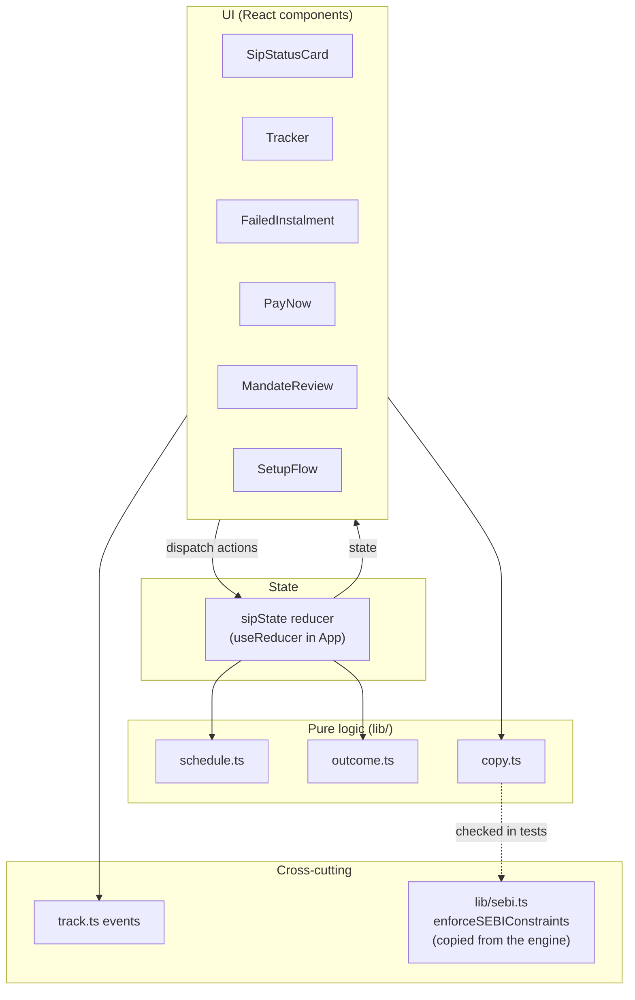
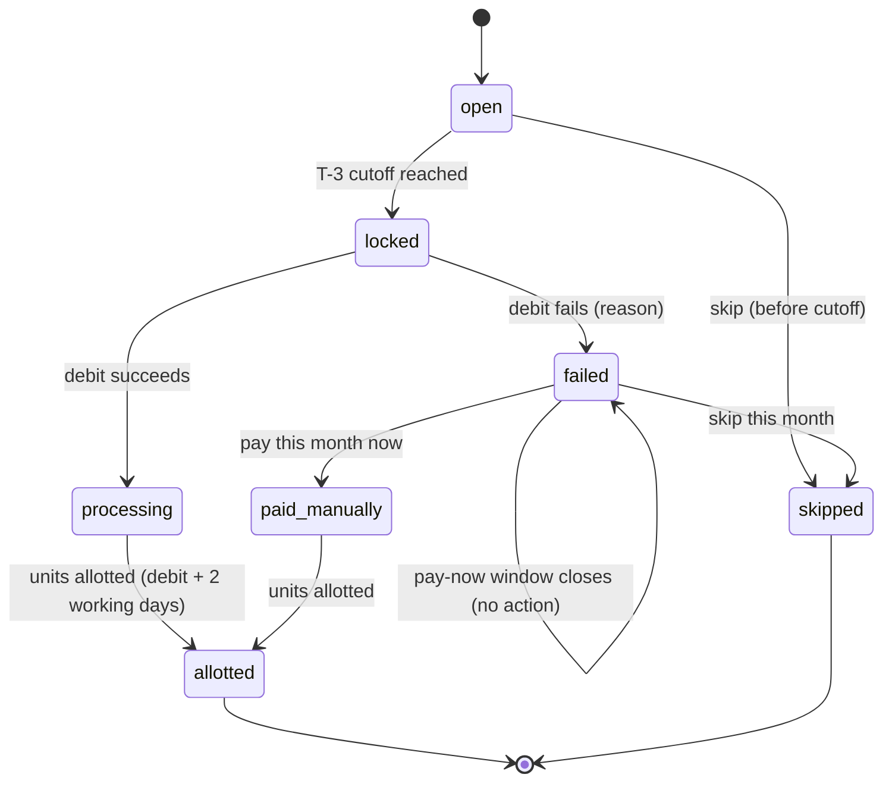
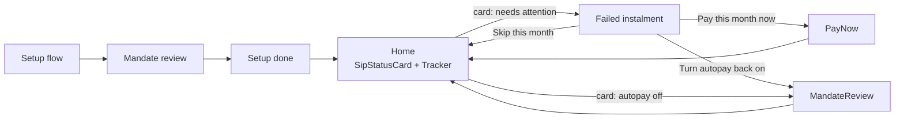
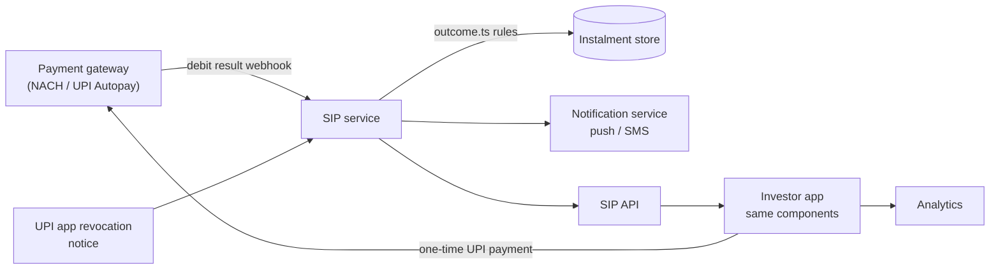

# MVP Architecture: Failed-Instalment Recovery

This document is the design for the MVP in [MVP_ImplementationPlan.md](MVP_ImplementationPlan.md). The discovery engine has its own [Architecture.md](https://github.com/Anku46/groww-sip-discovery/tree/main/Architecture.md) on the `main` branch.

## 1. Goals and constraints

**Goal.** When a SIP instalment fails, the investor learns about it, understands it in plain language, and can recover in one step.

**Constraints**
- **Prototype only.** Frontend-only, no backend. Payments, mandates, failures and notifications are simulated in the browser.
- **SEBI rules.** No fund picks, no return figures, no fear, urgency or guilt in any text. Enforced by tests using the shared SEBI enforcer.
- **Phone first.** Designed for a 375px screen; works on desktop.
- **Standalone.** Lives on its own `mvp` branch with no dependency on the engine. The engine's SEBI checker is copied into `mvp/src/lib/sebi.ts`, with the source commit noted at the top of the file.
- **Pure logic, thin UI.** All date, status and recovery rules are pure functions so they can be unit-tested and later moved to a backend unchanged.

## 2. Where it lives

```
mvp branch (root)
├── README.md
├── MVP_ImplementationPlan.md
├── MVP_Architecture.md
└── mvp/                        investor-facing prototype (standalone pnpm package)
    ├── index.html
    ├── vite.config.ts          port 5174, jsdom tests
    └── src/
        ├── App.tsx             screen routing, simulated clock, debug panel
        ├── lib/                pure logic, no React
        │   ├── schedule.ts     instalment dates, T-3 cutoff, mandate limits   (exists)
        │   ├── outcome.ts      failure reasons, statuses, recovery rules      (new)
        │   ├── sipState.ts     reducer for the whole SIP's state              (new)
        │   ├── copy.ts         all investor-facing text                       (exists, extended)
        │   ├── sebi.ts         SEBI checker, copied from the engine           (new)
        │   ├── timeline.ts     timeline steps + status summary per instalment (new)
        │   └── track.ts        event log                                      (exists, extended)
        ├── components/
        │   ├── SetupFlow.tsx           setup + mandate review                 (exists)
        │   ├── ScheduleList.tsx                                               (exists)
        │   ├── Tracker.tsx             timeline + simulation controls         (exists, extended)
        │   ├── SipStatusCard.tsx       "Is my SIP running?" + failure alert   (new)
        │   ├── FailedInstalment.tsx    what happened + actions                (new)
        │   ├── PayNow.tsx              simulated one-time payment             (new)
        │   ├── Confirmation.tsx        calm "done" screen after each action   (new)
        │   ├── MandateReview.tsx       extracted from SetupFlow, reused       (new)
        │   ├── NotificationPreview.tsx push / SMS preview                     (new)
        │   └── DebugPanel.tsx          event log + recovery funnel            (new)
        └── test/
```

## 3. Layers



- **UI** only renders state and dispatches actions. It does not compute dates or statuses.
- **State** is one reducer in `App` holding the SIP and its instalments. No external store is needed at this size.
- **Pure logic** has no React or browser APIs, so it runs in tests and could run on a server.
- **Copy** is data, not inline JSX strings, so every line can be checked by the SEBI test.

## 4. Domain model

### 4.1 Types (`lib/outcome.ts`, `lib/sipState.ts`)

```ts
type PaymentMethod = 'upi' | 'enach'                       // exists

type FailureReason =
  | 'insufficient_balance'   // money not in the account on debit day
  | 'mandate_revoked'        // autopay turned off in a UPI app
  | 'mandate_not_active'     // expired or never finished registering
  | 'bank_technical'         // bank / NPCI downtime or timeout
  | 'unknown'                // no reason returned

type InstalmentState =
  | { kind: 'open' }                          // before T-3 cutoff; changes apply now
  | { kind: 'locked' }                        // after cutoff, before debit
  | { kind: 'processing' }                    // debited, units pending
  | { kind: 'allotted' }                      // units in account
  | { kind: 'failed'; reason: FailureReason; failedOn: Date }
  | { kind: 'paid_manually'; paidOn: Date }   // recovered via pay-now
  | { kind: 'skipped' }

type MandateState = 'active' | 'revoked' | 'not_active'

interface SipState {
  config: { amount: number; sipDay: number; method: PaymentMethod }
  setupDay: Date
  today: Date                                  // simulated clock
  mandate: MandateState
  limit: number
  instalments: Installment[]                   // dates from schedule.ts
  overrides: Record<number, InstalmentState>   // simulated or user-driven outcomes
  simulatedOutcome: Record<number, 'success' | FailureReason>
}
```

An instalment's displayed state comes from `resolveState(sip, n)`:
1. If there is an override (failed, paid, skipped), use it.
2. Else, if today is on or after the debit date and the simulated outcome is a failure, it is `failed`.
3. Else, use the date-based status from `schedule.ts` (`open`, `locked`, `processing`, `allotted`).

### 4.2 Instalment lifecycle



Reconnecting autopay after `mandate_revoked` or `mandate_not_active` changes the **mandate** back to `active`; it does not by itself recover the failed month. The investor can also pay that month.

### 4.3 Rules (pure functions in `outcome.ts`)

| Function | Rule |
| :-- | :-- |
| `sipStillActive(mandate)` | `true` only when the mandate is `active`. |
| `moneyLeftAccount(state)` | `false` for `failed` and `skipped`; `true` for `processing`, `allotted`, `paid_manually`. |
| `bankChargeLikely(reason)` | `true` for `insufficient_balance`; `'possible'` for `bank_technical` and `unknown`; `false` for mandate reasons. |
| `payNowDeadline(next)` | 3 working days before the next instalment's cutoff (prototype assumption, see §9). |
| `recoveryOptions(reason, today, next)` | See table below. Pay-now is dropped once `today` passes the deadline. |
| `sipHealth(sip)` | `running`, `needs_attention` (latest instalment failed and unresolved) or `autopay_off`. |

| Reason | Primary action | Secondary action | Mandate after failure |
| :-- | :-- | :-- | :-- |
| `insufficient_balance` | Pay this month now | Skip this month | active |
| `bank_technical` | Pay this month now | Skip this month | active |
| `unknown` | Pay this month now | Contact support | active |
| `mandate_revoked` | Turn autopay back on | Pay this month now | revoked |
| `mandate_not_active` | Set up autopay again | Pay this month now | not_active |

### 4.4 Reducer actions (`sipState.ts`)

| Action | Effect |
| :-- | :-- |
| `SETUP_COMPLETED` | Creates `SipState` from setup; mandate `active`. |
| `SET_TODAY` | Moves the simulated clock. |
| `SIMULATE_OUTCOME` | Sets the outcome for instalment `n`; for mandate reasons also sets the mandate state. |
| `PAY_NOW` | Instalment → `paid_manually`; rejected if outside the deadline. |
| `SKIP` | Instalment → `skipped`. |
| `RECONNECT_MANDATE` | Mandate → `active`. |
| `RESET` | Back to setup. |

The reducer is pure and tested directly, without rendering.

## 5. Screens and navigation



Navigation is a `screen` value in `App` state (`setup | home | failed | payNow | reconnect`). No router is needed; the prototype has one entry URL, with `?debug` for the debug panel.

**Failed-instalment screen, top to bottom**
1. Title: what happened in one line.
2. Three facts: money (did it leave?), SIP (still on? next debit), bank charge (who charges it).
3. Why it happened, with a "what's this?" expander for jargon.
4. Primary and secondary actions from §4.3.

**Visual rules.** Failures use amber, never red. No countdown timers. Every action has a calm confirmation screen.

## 6. Copy and compliance

- All investor-facing text lives in `copy.ts`, keyed by reason and state:
  `FAILURE_COPY[reason] = { title, whatHappened, why }`; `FACT_COPY` (money, SIP still on, bank charge: the "what this means" lines, driven by the rules in `outcome.ts`); `ACTION_COPY`, `CONFIRMATION_COPY`, `ALERT_COPY` (banner, push and SMS), `STATUS_CARD_COPY` and `AUTOPAY_EXPLAINER`.
- Failure copy avoids payment jargon ("automatic payments", never "mandate", NACH, NPCI or "bounce"); only the explainer names the term "mandate".
- Dynamic values (amount, dates) are filled in by small template functions, so tests can render every combination.
- `copy.test.ts` runs every string, in every combination, through:
  1. `enforceSEBIConstraints` from `lib/sebi.ts` (the engine's checker, copied): must return no flags;
  2. the urgency-word and exclamation-mark check;
  3. a 160-character limit for SMS text.
- **Held copy:** the credit-score line stays behind a `PENDING_COMPLIANCE` flag and is not rendered until confirmed (open question 2).

## 7. Measurement

`track.ts` keeps an in-memory, append-only list of events; `DebugPanel` (visible with `?debug`) shows the log and the funnel.

| Event | Properties | Fired when |
| :-- | :-- | :-- |
| `instalment_failed` | n, reason | an instalment resolves to `failed` |
| `failure_alert_viewed` | n, reason | the status card shows the failure alert |
| `failure_screen_viewed` | n, reason | the failed-instalment screen opens |
| `recovery_started` | n, action | an action button is pressed |
| `recovery_completed` | n, action | pay-now, reconnect or skip finishes |
| `status_card_viewed` | state | the status card renders |
| existing setup events | | unchanged |

**Funnel:** failed → screen viewed → recovery started → recovery completed.

In a real build, `track()` is the single place to swap in the analytics client.

## 8. Testing

| Level | What | Where |
| :-- | :-- | :-- |
| Unit | Dates, cutoffs, rollovers | `schedule.test.ts` (exists) |
| Unit | Reasons × options, deadlines, `sipHealth` | `outcome.test.ts` |
| Unit | Reducer transitions, rejected actions | `sipState.test.ts` |
| Compliance | Every string through the SEBI enforcer, urgency and SMS checks | `copy.test.ts` (extended) |
| Component | Failure → screen → each recovery path; status card agrees with the tracker; event sequence | `app.test.tsx` and new component tests |
| Manual | Every reason × action at 375px in the browser, no console errors | Step 9 of the plan |

Tests use a fixed date (Mon 9 Nov 2026) so schedules are stable.

## 9. Assumptions and simplifications

- Only weekends are non-working days; bank holidays are ignored.
- Units are allotted on debit day + 2 working days.
- Pay-now is allowed until 3 working days before the next instalment's cutoff, so a manual payment and the next autopay debit never overlap. This needs confirming (open question 1).
- A failed debit never takes money from the investor's account; only a bank charge may apply.
- Mandate revocation is known to the platform immediately. In reality this may be delayed (open question 5).
- State is lost on reload. That is acceptable for a prototype.

## 10. Deployment

- `pnpm --filter @groww-sip/mvp build` produces a static `dist/`.
- Deployed to Vercel as a static site, the same way as the engine's dashboard: build locally, add a `vercel.json` with an SPA rewrite, upload with `vercel deploy --prod`.
- No environment variables or secrets.

## 11. Path to a real build

The pure-logic split means a real build mainly replaces the simulated inputs:



| Prototype piece | Replaced by |
| :-- | :-- |
| `SIMULATE_OUTCOME` | Debit result webhooks mapped to `FailureReason` |
| `SET_TODAY` | Real clock |
| `PayNow` simulated confirm | One-time UPI collect / intent for the missed amount |
| `MandateReview` simulated approve | Real mandate registration |
| `NotificationPreview` | Push and SMS sent by the SIP service on failure |
| In-memory `track.ts` | Analytics client |
| `useReducer` state | SIP API responses |

`outcome.ts`, `copy.ts` and `sebi.ts` move into a package shared with the engine, so the server, the app and the engine use the same rules and text.

## 12. Key decisions

| Decision | Why |
| :-- | :-- |
| Own `mvp` branch, separate from the engine | The MVP and the research engine evolve and deploy separately; the READMEs link the two. |
| Copy the SEBI checker instead of importing it | Keeps the branch standalone; the copy names its source commit and a test guards it. |
| Extend `mvp/`, not a new package | The setup, mandate review and tracker are already built and tested. |
| `useReducer` over Zustand or a router | One SIP, five screens; less code and easy to test. |
| Pure logic in `lib/` | Testable without React and portable to a backend. |
| All copy in one module | Lets one test enforce SEBI rules on every line. |
| Amber, not red, for failures | The research shows panic drives cancellation; the no-fear rule applies. |
| Simulation controls in the UI | Lets PMs and test users reach every scenario without real failures. |
